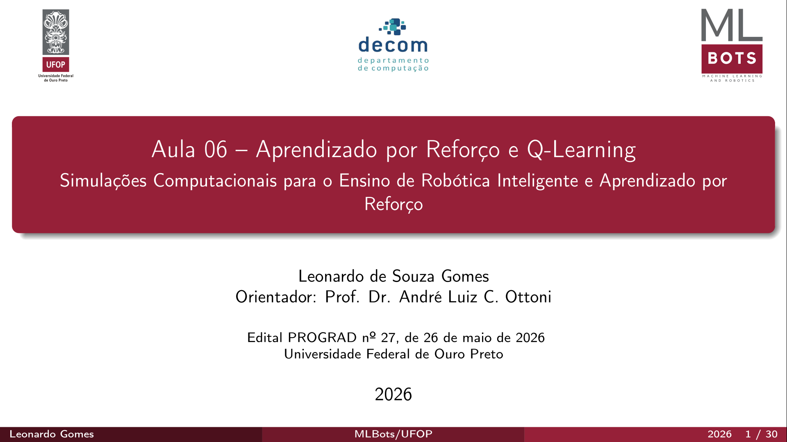
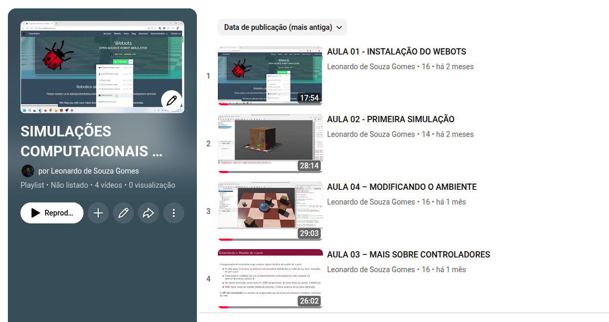
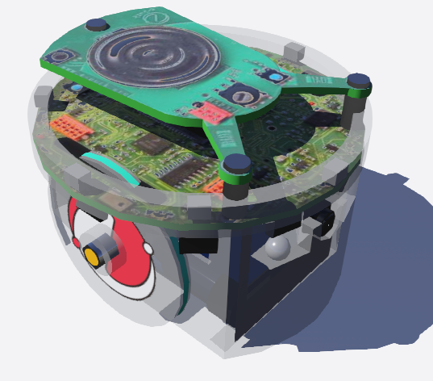
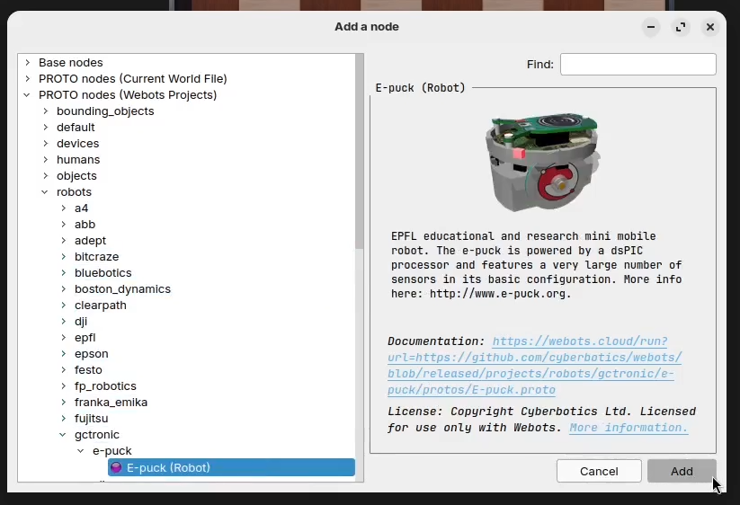
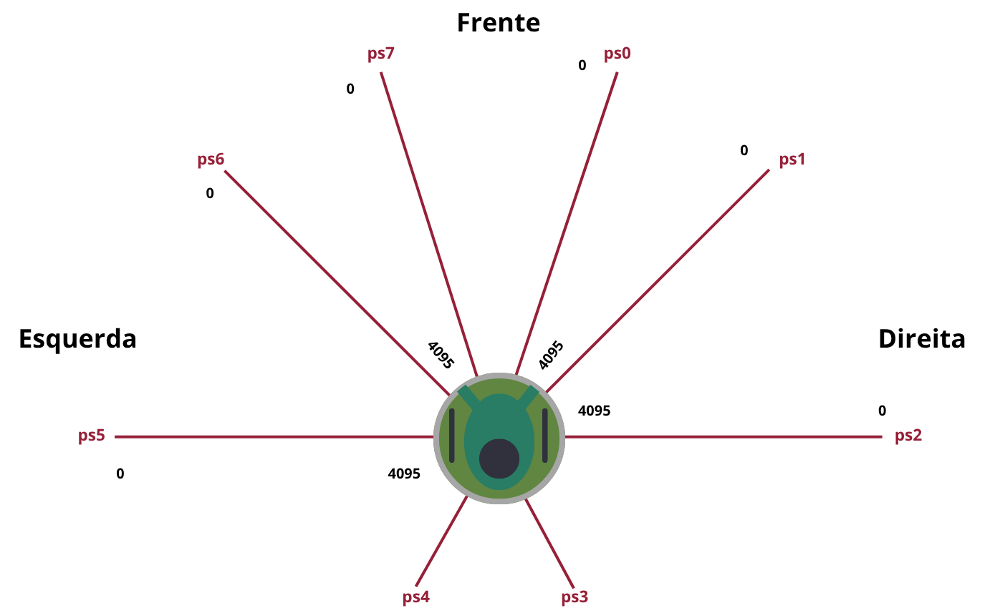
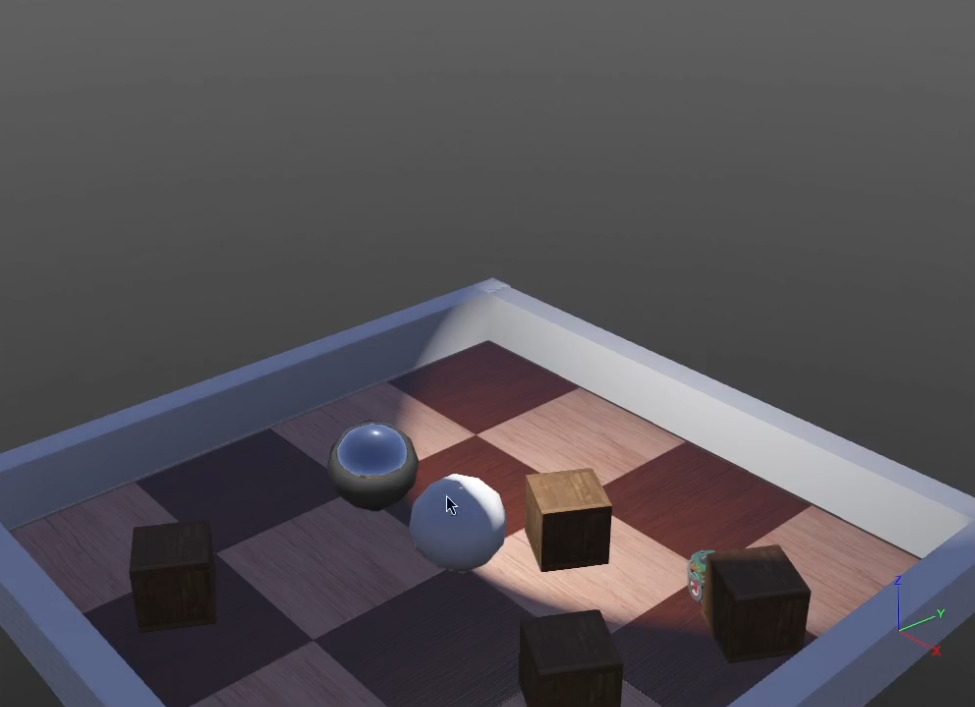
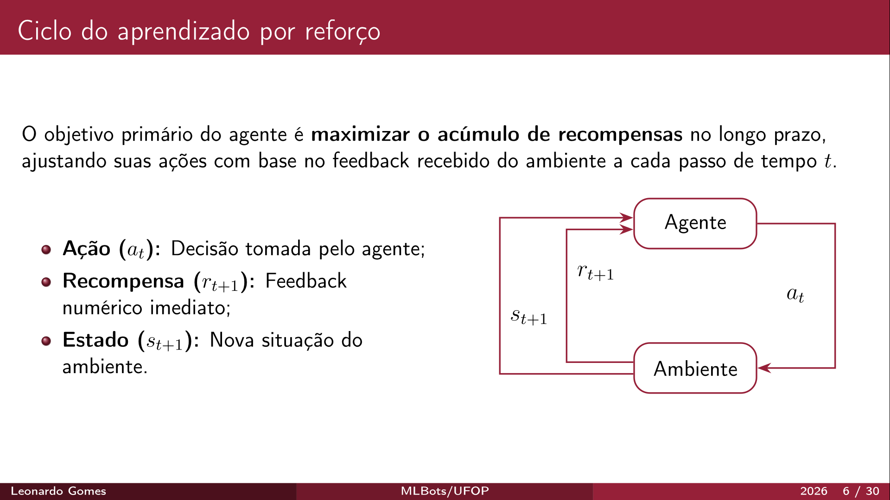

# Simulações Computacionais para o Ensino de Robótica Inteligente e Aprendizado por Reforço

Bem-vindo ao repositório do projeto **Simulações Computacionais para o Ensino de Robótica Inteligente e Aprendizado por Reforço**!

Este material foi desenvolvido como parte das atividades de ensino e pesquisa em robótica, utilizando o simulador **Webots** e abordando desde a criação de ambientes virtuais até o controle autônomo de robôs e conceitos de Aprendizado por Reforço.

> **Nota:** Material adaptado dos tutoriais oficiais do [Webots](https://cyberbotics.com/).

<p align="center">
  
</p>

---

## 📂 Estrutura do Repositório

| Item | Descrição |
| :--- | :--- |
| `01_instalacao.pdf` | Slides da Aula 1 - Introdução às Simulações Computacionais e Webots |
| `02_primeira_simulacao.pdf` | Slides da Aula 2 - Primeira simulação |
| `03_controladores.pdf` | Slides da Aula 3 - Sensores, Atuadores e Controladores |
| `04_ambiente.pdf` | Slides da Aula 4 - Modelagem e Modificação do Ambiente |
| `05_aparencia.pdf` | Slides da Aula 5 - Aparência de objetos |
| `06_QLearning.pdf` | Slides da Aula 6 - Treinamento do Q-Learning |
| `Codigos/` | Códigos dos controladores utilizados nas aulas |
| `Texturas/` | Texturas utilizadas nas simulações |

---

## 🎥 Videoaulas

| Aula | Descrição | Slides | Vídeo | Status |
| :---: | :--- | :---: | :---: | :---: |
| **01** | Aula 1 - Introdução às Simulações Computacionais e Webots | [PDF](01_instalacao.pdf) | [Assistir no YouTube](https://youtu.be/7o1xTCDoiL4) | 🟢 Disponível |
| **02** | Aula 2 - Modelagem e Modificação do Ambiente | [PDF](02_primeira_simulacao.pdf) | [Assistir no YouTube](https://youtu.be/VFdVK8f9Q0A) | 🟢 Disponível |
| **03** | Aula 3 - Sensores, Atuadores e Controladores | [PDF](03_controladores.pdf) | [Assistir no YouTube](https://youtu.be/euTb9rZo8Ig) | 🟢 Disponível |
| **04** | Aula 4 - Navegação e Controle do Robô | [PDF](04_ambiente.pdf) | [Assistir no YouTube](https://youtu.be/EQzjYMp2MEg) | 🟢 Disponível |
| **05** | Aula 5 - Aparência de objetos | [PDF](05_aparencia.pdf) | [Assistir no YouTube](COLOQUE_O_LINK_AQUI) | 🟢 Disponível |
| **06** | Aula 6 - Treinamento do Q-Learning | [PDF](06_QLearning.pdf) | — | 🟡 Vídeo em breve (slides disponíveis) |

<p align="center">
  
</p>

---

## 🖼️ Galeria

### Robô e-puck

| e-puck (vista 1) | e-puck (vista 2) | Sensores do e-puck |
| :---: | :---: | :---: |
|  |  |  |

### Outros robôs e conceitos

| Robô Spot | Ciclo do agente (Aula 6) |
| :---: | :---: |
|  |  |

---

## 👥 Autores e Equipe

* **Leonardo de Souza Gomes** — `leonardo.sg@aluno.ufop.br`
* **Prof. Dr. André Luiz C. Ottoni** (Orientador) — `andre.ottoni@ufop.edu.br`

---

## 🏛️ Apoio e Agradecimentos

Este trabalho foi realizado com o apoio da **Pró-Reitoria de Graduação (PROGRAD)**, do **Grupo de Pesquisa Machine Learning and Robotics (MLBots)** e do **Departamento de Computação (DECOM)** da **Universidade Federal de Ouro Preto (UFOP)**.

* **Projeto / Edital:** Edital PROGRAD nº 27, de 26 de maio de 2026
* **Instituição:** Universidade Federal de Ouro Preto (UFOP)

---

## 📚 Referências (BibTeX)

```bibtex
@book{russell_norvig,
  author    = {Russell, Stuart and Norvig, Peter},
  title     = {Inteligência Artificial: Uma Abordagem Moderna},
  publisher = {Elsevier},
  edition   = {3},
  year      = {2013}
}

@misc{cyberbotics_webots_tutorial1,
  author       = {{Cyberbotics}},
  title        = {Tutorial 1: Your First Simulation in {W}ebots},
  howpublished = {\url{[https://cyberbotics.com/doc/guide/tutorial-1-your-first-simulation-in-webots?tab-language=c](https://cyberbotics.com/doc/guide/tutorial-1-your-first-simulation-in-webots?tab-language=c)}},
  year         = {2026},
  note         = {Acesso em: 3 ago. 2026},
  urldate      = {2026-08-03}
}

@misc{cyberbotics_webots_tutorial2,
  author       = {{Cyberbotics}},
  title        = {Tutorial 2: Modification of the Environment},
  howpublished = {\url{[https://cyberbotics.com/doc/guide/tutorial-2-modification-of-the-environment?tab-language=c](https://cyberbotics.com/doc/guide/tutorial-2-modification-of-the-environment?tab-language=c)}},
  year         = {2026},
  note         = {Acesso em: 20 ago. 2026},
  urldate      = {2026-08-20}
}

@misc{cyberbotics_webots_tutorial3,
  author       = {{Cyberbotics}},
  title        = {Tutorial 3: Appearance},
  howpublished = {\url{https://cyberbotics.com/doc/guide/tutorial-3-appearance?tab-language=c}},
  year         = {2026},
  note         = {Acesso em: 23 ago. 2026},
  urldate      = {2026-08-23}
}

@misc{cyberbotics_webots_tutorial4,
  author       = {{Cyberbotics}},
  title        = {Tutorial 4: More about Controllers},
  howpublished = {\url{[https://cyberbotics.com/doc/guide/tutorial-4-more-about-controllers?tab-language=c](https://cyberbotics.com/doc/guide/tutorial-4-more-about-controllers?tab-language=c)}},
  year         = {2026},
  note         = {Acesso em: 15 ago. 2026},
  urldate      = {2026-08-15}
}

@misc{user_interface,
  author       = {{Cyberbotics}},
  title        = {The User Interfaces},
  howpublished = {\url{[https://cyberbotics.com/doc/guide/the-user-interface](https://cyberbotics.com/doc/guide/the-user-interface)}},
  year         = {2026},
  note         = {Acesso em: 12 ago. 2026},
  urldate      = {2026-08-12}
}

@misc{cyberbotics_system_requirements,
  author       = {{Cyberbotics}},
  title        = {System Requirements},
  howpublished = {\url{[https://cyberbotics.com/doc/guide/system-requirements](https://cyberbotics.com/doc/guide/system-requirements)}},
  year         = {2026},
  note         = {Acesso em: 3 ago. 2026},
  urldate      = {2026-08-03}
}
@misc{datacamp_qlearning,
  author       = {{Abid Ali Awan}},
  title        = {Introdução ao Q-learning: um tutorial para iniciantes},
  howpublished = {\url{https://www.datacamp.com/pt/tutorial/introduction-q-learning-beginner-tutorial}},
  year         = {2026},
  note         = {Acesso em: 17 set. 2026},
  urldate      = {2026-09-17}
}
